# UI Design Styles

A reusable AI-agent skill and visual reference library for applying, comparing, and reviewing recognizable UI design styles.

The project turns visual-style research into actionable implementation guidance: defining signals, style boundaries, CSS starting points, accessibility notes, and agent workflows.

> Research starting point: [NameThatUI — Name That Vibe: the visual styles atlas](https://namethatui.com/styles). This repository is an independent companion project, not affiliated with or endorsed by NameThatUI.

## Visual style gallery

Choose a style by previewing the original, independently created specimen illustrations below. Select a card to open its implementation reference.

<table>
<tr>
<td width="33%" valign="top">
<a href="references/glassmorphism.md">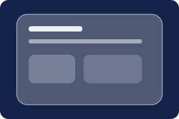</a>
<strong><a href="references/glassmorphism.md">Glassmorphism</a></strong><br>
<sub>Frosted translucent surfaces over a vivid, visible backdrop.</sub><br>
<sub><a href="https://namethatui.com/styles/glassmorphism">Original atlas entry ↗</a></sub>
</td>
<td width="33%" valign="top">
<a href="references/neumorphism.md">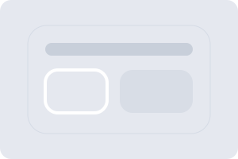</a>
<strong><a href="references/neumorphism.md">Neumorphism</a></strong><br>
<sub>Soft controls appear pressed out of, or inset into, one continuous matte surface.</sub><br>
<sub><a href="https://namethatui.com/styles/neumorphism">Original atlas entry ↗</a></sub>
</td>
<td width="33%" valign="top">
<a href="references/skeuomorphism.md">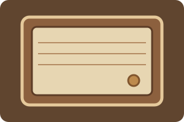</a>
<strong><a href="references/skeuomorphism.md">Skeuomorphism</a></strong><br>
<sub>Interface elements imitate recognizable physical objects, materials, and mechanisms.</sub><br>
<sub><a href="https://namethatui.com/styles/skeuomorphism">Original atlas entry ↗</a></sub>
</td>
</tr>
<tr>
<td width="33%" valign="top">
<a href="references/flat-design.md">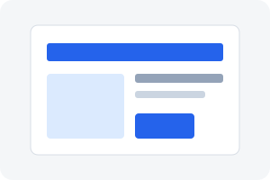</a>
<strong><a href="references/flat-design.md">Flat Design</a></strong><br>
<sub>Two-dimensional rendering, solid fills, and minimal simulated depth.</sub><br>
<sub><a href="https://namethatui.com/styles/flat-design">Original atlas entry ↗</a></sub>
</td>
<td width="33%" valign="top">
<a href="references/minimalism.md">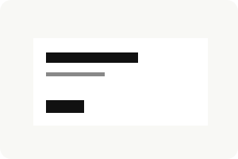</a>
<strong><a href="references/minimalism.md">Minimalism</a></strong><br>
<sub>Reduce what is on screen; use negative space and typography as primary composition tools.</sub><br>
<sub><a href="https://namethatui.com/styles/minimalism">Original atlas entry ↗</a></sub>
</td>
<td width="33%" valign="top">
<a href="references/web-brutalism.md">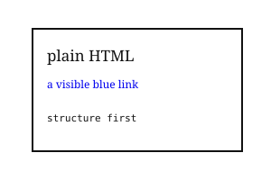</a>
<strong><a href="references/web-brutalism.md">Web Brutalism</a></strong><br>
<sub>Expose the web page's raw structure and browser-default character instead of polishing it.</sub><br>
<sub><a href="https://namethatui.com/styles/web-brutalism">Original atlas entry ↗</a></sub>
</td>
</tr>
<tr>
<td width="33%" valign="top">
<a href="references/neobrutalism.md">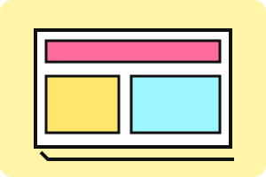</a>
<strong><a href="references/neobrutalism.md">Neobrutalism</a></strong><br>
<sub>A designed, graphic rawness: bold flat colors, thick ink-like outlines, and hard shadows.</sub><br>
<sub><a href="https://namethatui.com/styles/neobrutalism">Original atlas entry ↗</a></sub>
</td>
<td width="33%" valign="top">
<a href="references/claymorphism.md">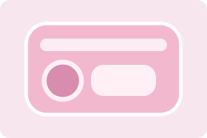</a>
<strong><a href="references/claymorphism.md">Claymorphism</a></strong><br>
<sub>Puffy, soft 3D objects that resemble molded clay or soft plastic.</sub><br>
<sub><a href="https://namethatui.com/styles/claymorphism">Original atlas entry ↗</a></sub>
</td>
<td width="33%" valign="top">
<a href="references/liquid-glass.md">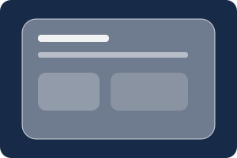</a>
<strong><a href="references/liquid-glass.md">Liquid Glass</a></strong><br>
<sub>Apple's adaptive glass material belongs to the floating control layer, not the content itself.</sub><br>
<sub><a href="https://namethatui.com/styles/liquid-glass">Original atlas entry ↗</a></sub>
</td>
</tr>
<tr>
<td width="33%" valign="top">
<a href="references/y2k.md">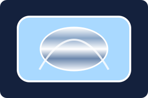</a>
<strong><a href="references/y2k.md">Y2K</a></strong><br>
<sub>Turn-of-the-millennium digital futurism: chrome, gel, iridescence, and techno typography.</sub><br>
<sub><a href="https://namethatui.com/styles/y2k">Original atlas entry ↗</a></sub>
</td>
<td width="33%" valign="top">
<a href="references/frutiger-aero.md">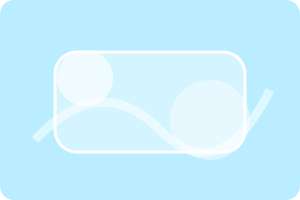</a>
<strong><a href="references/frutiger-aero.md">Frutiger Aero</a></strong><br>
<sub>Optimistic eco-tech: glossy interfaces, blue skies, water, greenery, and luminous bubbles.</sub><br>
<sub><a href="https://namethatui.com/styles/frutiger-aero">Original atlas entry ↗</a></sub>
</td>
<td width="33%" valign="top">
<a href="references/vernacular-web.md">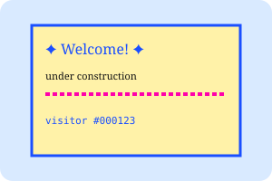</a>
<strong><a href="references/vernacular-web.md">Vernacular Web</a></strong><br>
<sub>The exuberant, handmade visual language of early personal websites.</sub><br>
<sub><a href="https://namethatui.com/styles/vernacular-web">Original atlas entry ↗</a></sub>
</td>
</tr>
<tr>
<td width="33%" valign="top">
<a href="references/aqua.md">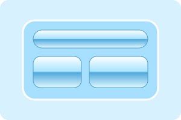</a>
<strong><a href="references/aqua.md">Aqua</a></strong><br>
<sub>The glossy, candy-like Mac OS X interface language of the early 2000s.</sub><br>
<sub><a href="https://namethatui.com/styles/aqua">Original atlas entry ↗</a></sub>
</td>
<td width="33%" valign="top">
<a href="references/windows-aero.md">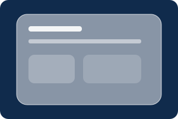</a>
<strong><a href="references/windows-aero.md">Windows Aero</a></strong><br>
<sub>The Windows Vista/7 glass-window language: translucent frames, reflections, and luminous controls.</sub><br>
<sub><a href="https://namethatui.com/styles/windows-aero">Original atlas entry ↗</a></sub>
</td>
<td width="33%"></td>
</tr>
</table>

## Included styles

The current atlas contains 14 entries:
Glassmorphism, Neumorphism, Skeuomorphism, Flat Design, Minimalism, Web Brutalism, Neobrutalism, Claymorphism, Liquid Glass, Y2K, Frutiger Aero, Vernacular Web, Aqua, and Windows Aero.

**Atlas note:** The live NameThatUI index should be treated as authoritative if its entries change. The style set is versioned in this repository and can be expanded independently.

## Install / use

### Claude Code and compatible skill loaders

Copy this directory into the agent's skills directory using the convention supported by your tool. For Claude Code, a project-level location is commonly:

```text
.claude/skills/ui-design-styles/
```

For agents that support the Agent Skills convention, place the folder in the configured skills directory. Keep `SKILL.md` and the `references/` folder together.

### Use in a coding task

```text
Use the ui-design-styles skill. Redesign the account dashboard
using Glassmorphism. Read the matching reference first, preserve
all existing functionality, and validate responsive and accessible states.
```

Other examples:

```text
Apply Neobrutalism to the marketing landing page without changing its content.
```

```text
Compare Glassmorphism and Liquid Glass, then recommend one for a data-heavy SaaS dashboard.
```

```text
Review this page against the Minimalism reference and report style drift separately from accessibility issues.
```

## What the skill can do

- **Design from scratch** using one named visual style.
- **Transform existing UI** while preserving routes, data flow, semantics, and behavior.
- **Review and audit** visual fidelity, style drift, and accessibility separately.
- **Compare close relatives** such as Glassmorphism vs Liquid Glass or Web Brutalism vs Neobrutalism.
- **Combine styles** with one primary style and a clearly scoped secondary influence.
- **Translate principles** into the project's existing stack (HTML/CSS, Bootstrap, Tailwind, React, Blazor, Flutter, etc.).

## Repository structure

```text
ui-design-styles/
├── SKILL.md
├── README.md
├── references/          # One practical guide per style
├── assets/styles/       # Original SVG specimen previews for this README
└── examples/html-css/   # Small implementation examples
```

## Design and accessibility principles

The skill treats style fidelity as subordinate to usability:
- Keep semantic HTML, labels, keyboard navigation, and visible focus.
- Preserve essential product behavior and information architecture.
- Check text contrast against the actual rendered background.
- Respect reduced-motion and reduced-transparency preferences.
- Provide fallbacks for effects such as `backdrop-filter`.
- Test narrow viewports and content reflow.
- Avoid adding dependencies or large decorative assets without a reason.

## Sources and attribution

- [NameThatUI — Visual styles atlas](https://namethatui.com/styles)
- [NameThatUI — Methodology](https://namethatui.com/methodology)
- Individual source links are listed in each `references/*.md` file.
- External images and text are not bundled from the source site. Gallery SVGs are original schematic illustrations created for this repository.
- Some reference files include links to primary platform or accessibility documentation. Confirm current API details and the applicable licenses before production use.

NameThatUI is independently created and maintained by its publisher. This repository is an unofficial, independently written implementation companion.

## Contributing

When adding a style:
1. Confirm that the style has a defensible name and a credible source.
2. Record its terminology status (established movement, vendor design language, retrospective label, or contested label).
3. Document defining and avoid signals, nearest look-alikes, and accessibility concerns.
4. Add a small, original preview specimen.
5. Add the source page and primary references.
6. Update the gallery and style table in this README.
